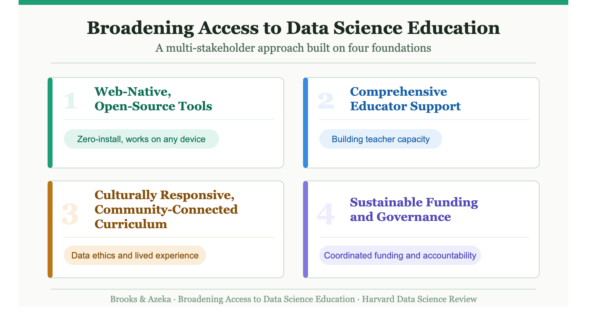

# Philosophy 摘录

## 数据科学、日常生活与 AI

> 来源：用户提供的英文摘录，其中提及 [HDSR 的 Recreations in Randomness 栏目](https://hdsr.mitpress.mit.edu/recreations-in-randomness)。摘录与原文的对应关系、作者和发表信息待核验。

Data science has a way of turning up in places where no one explicitly invited it. We live in a world saturated with data, and data science has become an increasingly pervasive way of reasoning about that world. It is there when we compare routes across town, tweak a workout plan, assemble a playlist, or try to guess why a recommendation system seems to know us a little too well. The premise of the *HDSR* column [Recreations in Randomness](https://hdsr.mitpress.mit.edu/recreations-in-randomness) has always been that data science is not only a professional practice or an academic discipline. It is also part of how we play, relax, compete, create, socialize, and make sense of everyday life.

The same habits of thought that help us study health risks, public decisions, or athletic performance can illuminate taste, recommendation systems, artistic choices, and social interaction. The methods may be technical, but the questions are often deeply human: What do we value? What can we predict? What remains uncertain? When does an algorithm make something better, and when does it take some of the fun out of it?

At the same time, AI raises new questions. What happens when a hobby becomes partially automated? Does a generative model expand creativity or standardize it? When does personalization become manipulation? How should we think about authorship when a poem, image, recipe, joke, or strategy is coproduced by a human and a machine? What kinds of data are used to train recreational AI systems, and whose tastes do they represent? How do we evaluate an AI assistant when the goal is enjoyment rather than accuracy alone?

## 数据科学教育、伦理与社会参与

> 用户提供的摘录及[文章链接](https://hdsr.mitpress.mit.edu/pub/tke5kviu/release/2?readingCollection=588fa300)。该页面本次未能打开，摘录与原文的对应关系及文中具体案例、研究结论待核验；原有引文标注在摘录中缺失。下方保留用户提供的文字，不能将其视为已核验的事实。

As data science, machine learning, artificial intelligence (AI), and other data-driven technologies play an increasingly central role in society, the importance of data science education is growing rapidly. From predicting health outcomes to influencing college admissions and criminal sentencing, data systems shape decisions that affect millions. Yet, these technologies are far from neutral. Several cases show how algorithmic bias has disproportionately harmed marginalized communities. For instance, the Correctional Offender Management Profiling for Alternative Sanctions (COMPAS) risk assessment tool has been used in thousands of criminal cases in the United States. It was found to incorrectly label Black defendants as high risk more often than White defendants . We also see algorithmic bias in Amazon’s AI recruitment system when it was shown to downgrade resumes that mentioned women’s colleges or organizations, reinforcing gender bias in hiring . In the United States, the University of California, Berkeley’s Data 8 course provides a potential model for scaling a more inclusive data science instruction. Designed for all majors, the course has catalyzed a statewide initiative—the California Alliance for Data Science Education (CADSE)—which develops open-source materials and provides training for educators across high schools and colleges. These models demonstrate the power of pairing curriculum with infrastructure and professional learning to achieve scale. The Data 8 course at UC Berkeley is powered by JupyterHub. (查查data 8课程）The curriculum embedded in this model should go beyond technical skills to address data ethics, justice, and civic engagement. Rooted in principles of culturally responsive pedagogy , such a curriculum would incorporate data sets and case studies that reflect students’ lived experiences and community concerns. It would also encourage critical thinking about data systems, including issues of privacy, surveillance, algorithmic bias, and bias in training data sets, while creating space for students to design and conduct their own investigations on topics that matter to them. Research underscores that connecting data science to social realities can foster both agency and equity by positioning students as critical consumers and producers of data ; . This emphasis helps students view data science not only as a career skill but also as a tool for social inquiry, justice, and empowerment.

用户提供的配图：

### Data 8 课程初查（2026-11-12）

- 【一手已核验：Berkeley 课程介绍】Data 8 面向各专业入门学生，无先修要求；结合推断、计算和真实数据，也涉及隐私和偏差。课程包括讲课、每周实验、作业和项目。[Berkeley 课程介绍](https://cdss.berkeley.edu/education/courses/data-8)
- 【一手已核验：课程网站】课程提供在线教材、作业和教学材料，许可各异：多数代码库使用 MIT、BSD 或 CC 许可；教材使用 CC BY-NC-ND 4.0，不允许分发改编作品。[Data 8 课程与材料](https://data8.org/)
- 【一手已核验：课程网站】课程使用托管的 DataHub 编辑和运行 notebook；2026 年春季材料也提供 Binder 运行入口。课程网站称，自 2025 年夏季起，Data 8 专用 DataHub 限当学期或上一学期选课学生访问；通用 DataHub 对 Berkeley 学生、教职员工开放。[课程基础设施](https://data8.org/)；[2026 春季材料](https://data8.org/materials-sp26/)。摘录称其由 JupyterHub 驱动；本次未查阅固定版本源代码，不进一步推断具体部署机制。
- 【一手已核验：Berkeley 官方项目介绍】CADSE 面向加州社区学院、州立大学和加州大学系统，提供包括 JupyterHub 计算资源、教师培训与课程支持等服务。[CADSE 官方介绍](https://cdss.berkeley.edu/dsus/californiaalliance)。该页面不足以核实摘录中 Data 8 催生 CADSE 的因果关系或其覆盖高中之说。

## 社会技术系统、解决主义与风险

> 用户提供的摘录；来源已核验为 Kroll 等，[《Unsafe at any AUC》](https://hdsr.mitpress.mit.edu/pub/tarzjxgu/release/2)。以下保留用户原文和注记；摘录中的具体因果解释需结合原始研究及监管调查判断。详见[系统安全与硅谷银行研究](../research/reports/系统安全与硅谷银行.md)。

Concretely, this includes technical subsystems (data collection and quality controls; data pipelines; feature generation; model training workflows; deployment infrastructure; user interfaces; logging and auditing; benchmarks and evaluation suites) as well as human and organizational processes (problem formulation and requirements analysis; metric selection and objective setting; review and approval processes; stakeholder engagement; procurement and system integration practices; individual and institutional incentives; cultural practices and beliefs; and political-economic forces). This definition is intentionally broad, as systems safety shows us how harms may befall humans from system behaviors as mediated through complex sociotechnical systems. a belief in technical solutions to human concerns (or ‘solutionism,’  ). （查查什么是solutionism）

In AI systems, one widely cited example  was a health care machine learning model used to allocate care for high-risk patients, which used actual health care costs as a proxy for each patient’s medical severity. Because structural inequalities in the United States mean Black patients spend far less on health care for equivalent conditions, the model systematically underestimated Black patients’ health needs. While the developers were explicitly concerned with the risk of bias, they failed to perceive that their choice proxy variable obscured this risk. -- fetch这个论文和case作为我们的案例之一

Organizational culture can lead individuals to hide ‘bad news,’ especially when it might affect output or if no solution is available. This leads employees to keep secret information that might have averted disaster. The risk department of Silicon Valley Bank performed an internal stress test using its own risk models, which revealed vulnerability of the bank’s bond portfolio to a rise in interest rates. This finding led the risk organization to change core assumptions in the bank’s risk model relating deposit income to changes in interest rates. Approximately 2.5 years later, sales of bonds at a loss tied to rising interest rates were the proximate inciting factor to a run on the bank’s assets that led to its collapse . Incentives for short-term profit, coupled with a culture that rejected information that threatened desired business growth, led the bank to accept more risk than it could bear. -- 硅谷银行的例子我需要完整时间线和报道

【核验提示】医疗案例见 [Obermeyer 等 2019 原论文全文](https://www.ftc.gov/system/files/documents/public_events/1548288/privacycon-2020-ziad_obermeyer.pdf)；关于开发者事先心理状态的说法需进一步证据。SVB 的 2020 年警报、2022 年利率风险假设更改及另一次流动性假设更改不能直接认定为同一因果链，也未找到足以证明员工秘密隐瞒警报的证据。[来源和时间线](../research/reports/系统安全与硅谷银行.md)。

## 数据治理、价值分配与代表性

> 摘录来源已核验：Ann Borda 和 Bastian Greshake Tzovaras，[《AI and Collective Data Governance in Crowdsourced Citizen Science: A Normative Framework Approach》](https://hdsr.mitpress.mit.edu/pub/3lifzyl3/release/2)，HDSR，2026-10-29。文章是观点与规范框架，以下保留用户提供的文字；原文引文在复制时缺失，其经验性主张尚未逐一核验原始研究，不能视为本项目已独立证实的事实。

An intertwined factor further concerns the notion that data acquired through mechanisms leading to monopolisation of these data are proprietary to the agent (as in big tech AI companies) that collects them ; . These data resources can encompass personal and consumer data, medical records, public funded research data, and user-generated data (such as data contributed or generated by citizen scientists), among other data types. They can extract profit by procuring large amounts of data without fair compensation for the data’s fair market value or the labor in producing these data ; ; . Not least in the AI context, there is a predilection toward mass value extraction of data rather than reciprocal value creation . Given this already existing tension, AI/ML applications can exacerbate the issues, particularly due to the tendency of such tools to overpower alternative modes of knowing and stewardship . Consequently, the promise of enhancing governance and engagement with public research may not always align with democratic ideals and citizen scientists may unwittingly contribute to knowledge production to the benefit of profit organizations ; . Social sustainability ideally focuses on aspects of representation and how fair an AI/ML system depends heavily on the representativeness of the underlying data, as well as the quality of the collected data. Further, it is well evidenced that the Majority World has greater data deficits ; ; ; ;  manifested in limited availability of data, data interoperability and quality, and nonrepresentative data . The harmful impact of data underrepresentation in AI/ML models directly affects sectors like healthcare and finance. For example, existing biomedical data for developing medical AI models underrepresent the diversity of human populations . This results in high-income countries having access to more contextually appropriate AI tools for clinical diagnosis and healthcare management .

### 加入讨论的问题

以下是根据文章观点提出的讨论问题，不是对所有项目或模型的实证结论：

- **数据与劳动**：谁收集、标注和维护数据？谁决定访问和再利用？贡献者是否知情，收益如何分配？数据收集、数据控制与法律上的所有权不能直接画等号。
- **参与和治理**：公民科学参与者能否参与决定研究目的、商业使用和争议处理？文章讨论数据公地、数据合作社等集体治理方案，同时指出这些方案仍需更严格检验，也可能重新集中权力。[文章摘要](https://hdsr.mitpress.mit.edu/pub/3lifzyl3/release/2)
- **数据缺口与适用性**：某一数据集覆盖了哪些人、地区和情境，遗漏了谁？用到医疗或金融案例时，应逐项核查数据来源、目标人群及外部验证；代表性并非公平的唯一条件。
- **与已有案例相连**：Obermeyer 医疗案例提醒我们，即使关注群体差异，还要检查模型优化的代理指标是否对应真实需求；数据治理讨论进一步追问谁有权决定这些目标和数据的使用方式。[案例研究](../research/reports/系统安全与硅谷银行.md)
